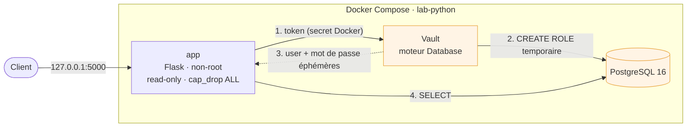

# Hardened Flask App

[](https://github.com/xoudev/hardened-flask-app/actions/workflows/ci.yml)


-4445E7)

API Flask minimale, volontairement entourée de tout ce qu'une application doit avoir avant d'aller en production :
**identifiants de base de données éphémères délivrés par HashiCorp Vault**, image Docker durcie,
conteneur verrouillé à l'exécution et pipeline CI qui scanne le code, les dépendances, l'image et l'application en marche.

L'application est petite exprès : ce dépôt est un **lab d'apprentissage DevSecOps**, et ce qui compte ici,
c'est la chaîne qui l'entoure. Ce README dit ce qui est fait, ce qui est accepté comme risque,
ce que j'ai appris et ce qu'il me reste à apprendre.

> L'infrastructure Azure prévue pour l'héberger est dans
> [`hardened-azure-infrastructure`](https://github.com/xoudev/hardened-azure-infrastructure).

---

## Sommaire

1. [Ce que ça démontre](#ce-que-ça-démontre)
2. [Architecture](#architecture)
3. [Durcissement du conteneur](#durcissement-du-conteneur)
4. [Le pipeline CI](#le-pipeline-ci)
5. [Risques acceptés et points faibles connus](#risques-acceptés-et-points-faibles-connus)
6. [Ce que j'ai appris](#ce-que-jai-appris)
7. [Ce qu'il me reste à apprendre](#ce-quil-me-reste-à-apprendre)
8. [Lancer le projet](#lancer-le-projet)
9. [Structure du dépôt](#structure-du-dépôt)

---

## Ce que ça démontre

Chaque appel à l'API demande à Vault un **nouvel utilisateur PostgreSQL à durée de vie limitée** (1 h par défaut, 24 h au maximum).
Aucun mot de passe de base n'est écrit dans le code, dans l'image ou dans une variable d'environnement.
Trois appels de suite, trois identités différentes :

```console
$ curl -s http://127.0.0.1:5000/ | jq -r .connected_as
v-token-app-read-zyMD5Mci8cDCgPGEtpbG-1793606089
$ curl -s http://127.0.0.1:5000/ | jq -r .connected_as
v-token-app-read-FwqHbuGKBdW6vZ6UkOr4-1793606089
$ curl -s http://127.0.0.1:5000/ | jq -r .connected_as
v-token-app-read-au32Yf01Qy1dVXiYb3m7-1793606090
```

Ces comptes n'ont que le droit `SELECT` sur la seule table dont l'application a besoin.
Si l'un d'eux fuite, il expire tout seul.

## Architecture



Trois réseaux Docker :

| Réseau | Type | Qui l'utilise |
|---|---|---|
| `frontend-net` | normal | l'application (seul point d'entrée, lié à `127.0.0.1`) |
| `db-net` | **`internal`** (pas de sortie vers Internet) | application, Vault, PostgreSQL |
| `vault-net` | **`internal`** | application, Vault |

PostgreSQL n'est donc joignable que depuis `db-net`, et Vault n'est pas exposé hors de la machine.

## Durcissement du conteneur

| Mesure | Où | Pourquoi |
|---|---|---|
| Build **multi-stage** | `Dockerfile` | L'image finale ne contient ni `pip`, ni compilateur, ni outillage de build |
| Image de base **Chainguard**, épinglée par **digest** `sha256` | `Dockerfile` | Très peu de paquets donc très peu de CVE. Un tag peut être réécrit, un digest non |
| Utilisateur **non-root** (UID `65532`) | `Dockerfile` | Un processus compromis n'est pas root dans le conteneur |
| `.dockerignore` en **liste blanche** | `.dockerignore` | Seuls `requirements.txt` et `app/` entrent dans le contexte de build |
| Système de fichiers en **lecture seule** + `tmpfs` `noexec,nosuid,nodev` | `docker-compose.yml` | Impossible d'écrire ou d'exécuter un binaire déposé par un attaquant |
| `cap_drop: ALL` | `docker-compose.yml` | Aucune capability Linux : l'application n'en a pas besoin |
| `no-new-privileges` | `docker-compose.yml` | Interdit l'élévation de privilèges via setuid |
| Profil **seccomp** personnalisé | `docker/seccomp-flask.json` | Bloque `ptrace`, `reboot`, `kexec_load`, `init_module`, `process_vm_*`... |
| Limites **cgroups** : 256 Mo, 0,5 CPU, 50 processus | `docker-compose.yml` | Limite les dégâts d'un déni de service ou d'une fork bomb |
| **Secrets Docker** (`/run/secrets`) | `docker-compose.yml` | Visibles par le conteneur seulement, absents de `docker inspect` contrairement à une variable d'environnement |
| Ports liés à `127.0.0.1` | `docker-compose.yml` | Rien n'est exposé sur le réseau de l'hôte |
| Healthchecks et `depends_on: service_healthy` | `docker-compose.yml` | L'application ne démarre pas avant que sa base réponde |

### Sécurité applicative

- **En-têtes HTTP** sur chaque réponse, y compris les 404 et 500 : `Content-Security-Policy` stricte,
  `X-Frame-Options: DENY`, `X-Content-Type-Options: nosniff`, `Cross-Origin-Opener-Policy`,
  `Cross-Origin-Resource-Policy`, `Permissions-Policy`, `Cache-Control: no-store`.
- **Bannière masquée** : `Server: Werkzeug/x.y Python/z` est remplacé par `api-gateway`.
- Configuration par variables d'environnement, aucune valeur sensible en dur.
- `/health` ne touche ni Vault ni la base : une sonde de vie ne doit pas dépendre de ses dépendances.

## Le pipeline CI

Workflow [`ci.yml`](.github/workflows/ci.yml), déclenché sur les PR et les pushes vers `main`. Trois jobs enchaînés,
chacun conditionné au précédent :

| Job | Contrôle | Outil | Bloquant |
|---|---|---|---|
| **Code, tests, SAST** | Secrets dans tout l'historique git | gitleaks | oui |
| | Lint du Dockerfile | hadolint | oui (niveau `error`) |
| | CVE des dépendances (`requirements.txt`) | Trivy fs | oui (HIGH, CRITICAL) |
| | Lint Python | Ruff | oui |
| | Tests unitaires | pytest | oui |
| | Analyse statique du code | Semgrep | oui |
| **Image, SCA** | Build de l'image | Docker | oui |
| | CVE des bibliothèques Python de l'image | Trivy image | oui (HIGH, CRITICAL) |
| | CVE du système de l'image | Trivy image | non, rapport seulement |
| **DAST** | Scan de l'application **en fonctionnement** | OWASP ZAP baseline | oui |

À savoir :

- Toutes les actions tierces sont **épinglées par SHA de commit**.
- Les règles ZAP sont dans [`.zap/rules.tsv`](.zap/rules.tsv). La fuite de version via l'en-tête `Server` est en `FAIL`,
  les autres règles ignorées sont chacune justifiées dans le fichier.
- Les exceptions Trivy sont dans [`.trivyignore`](.trivyignore), avec le motif.

## Risques acceptés et points faibles connus

Ce lab n'est pas une production. Voici ce qui est assumé, et ce qu'un audit relèverait.

| Point faible | Pourquoi | Correctif prévu |
|---|---|---|
| Vault en **mode dev** (stockage en mémoire, pas de TLS, pas d'unseal) avec le **root token** `myroottoken` | Facilite le lab : tout est reconfiguré à chaque `reset_lab.sh` | Mode serveur avec stockage persistant, TLS, politiques à moindre privilège |
| L'application s'authentifie à Vault **avec le root token** | Raccourci du lab | AppRole (ou auth Kubernetes) avec une politique limitée au rôle `app-readwrite` |
| Mot de passe de PostgreSQL de démonstration généré dans `secrets/` | Local, ignoré par git, jamais commité | Géré par Vault ou Azure Key Vault |
| `hashicorp/vault:latest` et `postgres:16-alpine` **non épinglés par digest** | Oubli de cohérence avec l'image de l'application | Épingler par digest, et vérifier avec Dependabot |
| Stage `builder` en `chainguard/python:latest-dev` non épinglé | Le builder n'est pas livré, mais un build n'est pas reproductible | Épingler par digest |
| Profil seccomp en **liste de blocage** (`defaultAction: ALLOW`, 12 appels refusés) | Simple à écrire et à maintenir | Profil en liste blanche construit à partir d'un `strace` |
| Conteneur PostgreSQL moins durci que l'application (`no-new-privileges` seulement) | L'image officielle écrit dans plusieurs répertoires et change d'utilisateur au démarrage | `cap_drop` ciblé, `read_only` avec `tmpfs` adaptés |
| Serveur de développement Flask | Suffisant pour un lab | Gunicorn |
| Exceptions de `.trivyignore` sans date d'échéance | Elles sont motivées, mais pas datées | Ajouter une échéance de revue à chaque entrée |

## Ce que j'ai appris

**Docker et conteneurs**
- Appliquer concrètement les restrictions d'un conteneur Linux : **cgroups** (limites mémoire, CPU, processus), **capabilities** (`cap_drop: ALL`), seccomp, système de fichiers en lecture seule.
- Pourquoi moins de paquets signifie moins de CVE, et pourquoi on épingle par digest plutôt que par tag.
- La différence entre un secret Docker et une variable d'environnement (visible dans `docker inspect`).

**Gestion des secrets**
- Un secret **dynamique** (créé à la demande, expire seul) est meilleur qu'un secret statique « bien caché ».
- Configurer le moteur *Database* de Vault : connexion à PostgreSQL, rôle, `CREATE ROLE ... VALID UNTIL`, TTL.
- Passer un mot de passe par `stdin` (`password=-`) pour qu'il n'apparaisse ni dans la liste des processus ni dans l'historique du shell.

**Sécurité applicative**
- Lire un rapport ZAP, distinguer un vrai positif d'un faux positif et justifier une règle ignorée.
- Les en-têtes de sécurité HTTP et le rôle de chacun.
- Tester ce que le client de test ne voit pas : le doublon d'en-tête `Server` n'existait qu'au niveau socket. Un test sur un vrai serveur Werkzeug l'a mis en évidence, et révélé une espace parasite dans la valeur.
- Ne jamais renvoyer le détail d'une exception au client : message générique côté réponse, détail et trace dans les logs. Prouvé par deux tests (`caplog` pour les logs, absence de la chaîne secrète dans la réponse).

**CI/CD DevSecOps**
- Chaîner des jobs avec `needs`, épingler les actions par SHA, ne donner que les permissions nécessaires.
- Brancher secrets, SAST, SCA, scan d'image et DAST dans une même chaîne (shift left).
- Résoudre un CVE de l'image de base : vérifier que le digest courant du fournisseur le corrige, le comparer à l'ancien avec Trivy, puis épingler le nouveau.
- Documenter un risque résiduel plutôt que de désactiver silencieusement un contrôle.

**Python**
- Structurer une API : factory `create_app()`, blueprints, séparation routes / services / configuration (principe 12-factor).
- Tests avec pytest : fixtures, client de test Flask, isolation des dépendances externes avec `unittest.mock`.

**Scripting**
- Bash robuste (`set -euo pipefail`), attente active des services, scripts idempotents.

## Ce qu'il me reste à apprendre

- [ ] **Vault en production** : stockage persistant, TLS, unseal, politiques, AppRole à la place du root token
- [ ] Gunicorn derrière un reverse proxy, journalisation JSON structurée, gestion d'erreurs sans fuite d'information
- [ ] Épingler **toutes** les images par digest et verrouiller les dépendances Python avec leurs empreintes
- [ ] Profil seccomp en liste blanche, durcissement du conteneur PostgreSQL, Docker rootless ou Podman
- [ ] **SBOM** (Syft ou Trivy CycloneDX) à chaque build, **signature d'image** avec cosign en mode keyless, provenance SLSA
- [ ] Publication de l'image dans un registre privé (Azure Container Registry) et vérification de la signature avant déploiement
- [ ] Déploiement sur **Azure Container Apps** avec identité managée, sans aucun mot de passe stocké
- [ ] Migrations de schéma versionnées (Alembic), pool de connexions avec rotation des identifiants éphémères
- [ ] Observabilité : métriques (Prometheus, Grafana), alertes, détection runtime (Falco)
- [ ] Dependabot sur pip, Docker et GitHub Actions, protection de la branche `main`, commits signés, `pre-commit`
- [ ] Introduire volontairement une injection SQL, la faire détecter par Semgrep puis par ZAP, la corriger
- [ ] **Kubernetes** : traduire le `docker-compose.yml` en conservant tout le durcissement (`securityContext`, NetworkPolicies, Kyverno)
- [ ] Threat model STRIDE de l'ensemble

## Lancer le projet

Prérequis : Docker avec Compose v2.

```bash
# Stack complète (application + PostgreSQL + Vault) : build, schéma, configuration de Vault, test
./scripts/reset_lab.sh

# L'API répond ensuite sur http://127.0.0.1:5000
curl -s http://127.0.0.1:5000/health     # {"status":"healthy"}
curl -s http://127.0.0.1:5000/ | jq       # lit la base avec des identifiants éphémères
```

Développement local sans Docker :

```bash
python -m venv .venv && source .venv/bin/activate
pip install -r requirements.txt -r requirements-dev.txt

pytest            # tests
ruff check .      # lint
python -m app     # lance l'API (Vault et PostgreSQL requis pour GET /)
```

Rejouer la CI en local :

```bash
hadolint Dockerfile
trivy fs --scanners vuln --severity HIGH,CRITICAL --ignore-unfixed .
docker build -t hardened-flask-app .
trivy image --severity HIGH,CRITICAL --ignore-unfixed hardened-flask-app
```

> Les secrets de `secrets/` sont des valeurs de démonstration, générées au premier lancement et ignorées par git.
> Ne les réutilise nulle part.

## Structure du dépôt

```
app/                    Code de l'API (package Python)
  __init__.py           create_app() : assemble l'application
  __main__.py           Point d'entrée : python -m app
  config.py             Lecture des variables d'environnement
  security.py           En-têtes HTTP de sécurité + masquage de la bannière Werkzeug
  routes.py             Endpoints : / et /health
  services/
    vault.py            Identifiants de base éphémères depuis Vault
    database.py         Requêtes PostgreSQL
tests/                  Tests pytest (conftest.py fournit le client de test)
docker/
  seccomp-flask.json    Profil seccomp du conteneur applicatif
  vault/vault.json      Configuration Vault en mode serveur (non utilisée en mode dev)
db/backup.sql           Dump PostgreSQL de référence
scripts/reset_lab.sh    Monte et configure toute la stack
secrets/                Secrets locaux (ignorés par git)
.zap/rules.tsv          Règles du scan DAST
.github/workflows/      Pipeline CI
Dockerfile · docker-compose.yml · .dockerignore · .trivyignore
```
